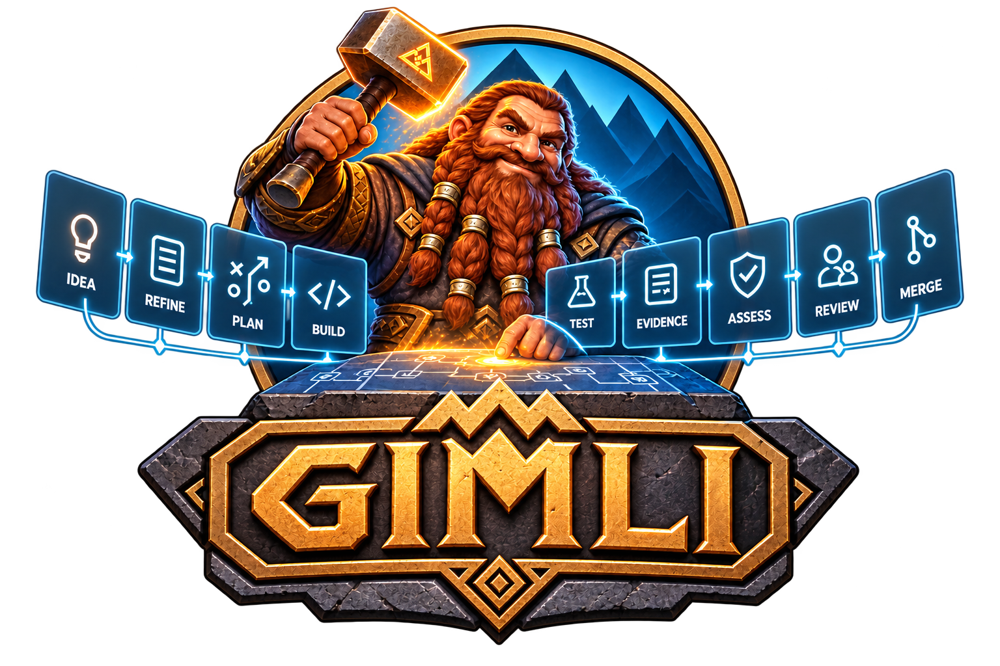
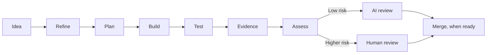

# Gimli

	

Gimli is an agentic software development system that takes work from idea to proven implementation, with human involvement based on risk rather than fixed process gates.

## How it works

Start with a PBI or issue. Gimli helps refine it interactively, clarifying the goal, scope, requirements, acceptance criteria, technical considerations, and expected test evidence. Once the work is sufficiently defined, Gimli takes responsibility for moving it through the development lifecycle.

Gimli plans the implementation, delegates work to appropriate coding agents, implements the change, and runs automated tests. It validates the result against the acceptance criteria and adds test evidence to the pull request.

## Development lifecycle

## Human involvement

Gimli assesses the complexity, impact, and risk of every change. Small, well-understood changes can follow a highly autonomous path through implementation, testing, and AI review, and may merge without manual intervention. Larger or higher-risk changes are presented to a human with the implementation, reasoning, test results, and evidence needed for an effective review.

## Orchestrated development

Gimli is more than an AI coding agent: it orchestrates the development process. Coding agents are workers Gimli can employ; GitHub provides work items, source control, pull requests, and an audit trail. Humans remain responsible for decisions where human judgment is valuable.