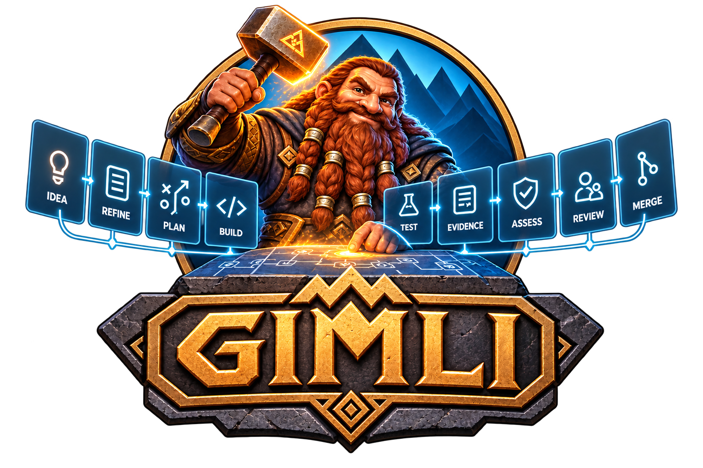

# Gimli

<p align="center">
	
</p>

Gimli is an agentic software development system that takes work from idea to proven implementation, with human involvement based on risk rather than fixed process gates.

This README is the starting point. Each section gives the short version and links to the document that holds the detail; the [documentation map](#documentation) lists them all.

## How it works

Start with a PBI or issue. Gimli helps refine it interactively, clarifying the goal, scope, requirements, acceptance criteria, technical considerations, and expected test evidence. Once the work is sufficiently defined, Gimli takes responsibility for moving it through the development lifecycle.

Gimli plans the implementation, delegates work to appropriate coding agents, implements the change, and runs automated tests. It validates the result against the acceptance criteria and adds test evidence to the pull request.

Gimli is more than an AI coding agent: it orchestrates the development process. Coding agents are workers Gimli can employ; GitHub provides work items, source control, pull requests, and an audit trail. Humans remain responsible for decisions where human judgment is valuable.

This repository is both the product and its first user: every change to Gimli goes through the lifecycle below.

## Development lifecycle

```mermaid
flowchart LR
	idea[Idea] --> refine[Refine] --> plan[Plan] --> build[Build]
	build --> test[Test] --> evidence[Evidence] --> assess[Assess]
	assess --> aiReview[AI review]
	aiReview -->|Low risk| merge[Merge, when ready]
	aiReview -->|Higher risk| humanReview[Human review]
	humanReview --> merge

	classDef human fill:#fde68a,stroke:#b45309,color:#1f2937
	classDef skill fill:#bfdbfe,stroke:#1d4ed8,color:#1f2937
	classDef workflow fill:#bbf7d0,stroke:#15803d,color:#1f2937
	classDef manual fill:#e5e7eb,stroke:#4b5563,color:#1f2937,stroke-dasharray:4 3
	class idea,humanReview human
	class refine,plan,build skill
	class aiReview workflow
	class test,evidence,assess,merge manual

	click idea "docs/lifecycle.md#1-idea" "Idea stage" _blank
	click refine "docs/lifecycle.md#2-refine" "Refine stage" _blank
	click plan "docs/lifecycle.md#3-plan" "Plan stage" _blank
	click build "docs/lifecycle.md#4-build" "Build stage" _blank
	click test "docs/lifecycle.md#5-test" "Test stage" _blank
	click evidence "docs/lifecycle.md#6-evidence" "Evidence stage" _blank
	click assess "docs/lifecycle.md#7-assess" "Assess stage" _blank
	click aiReview "docs/ai-review.md" "AI review" _blank
	click humanReview "docs/lifecycle.md#8-review" "Review stage" _blank
	click merge "docs/lifecycle.md#9-merge" "Merge stage" _blank
```



The colours show who carries out each stage today:
🟨 a human decides ·
🟦 a Claude Code skill does the work and asks a human to confirm ·
🟩 a GitHub workflow runs it automatically ·
⬜ done by hand today, to be automated (dashed).
Click a stage to open its definition.

Each stage has entry and exit criteria and leaves an artifact on GitHub. The specification is [`docs/lifecycle.md`](docs/lifecycle.md):

| Stage | What happens | Artifact |
|---|---|---|
| [Idea](docs/lifecycle.md#1-idea) | A need is captured as an issue from the work item template. | Issue with `stage:refine` |
| [Refine](docs/lifecycle.md#2-refine) | The issue is clarified until its acceptance criteria are testable and its scope is stated. | Refined issue body |
| [Plan](docs/lifecycle.md#3-plan) | Steps, affected files, documentation to update, tests per criterion and a risk tier are decided. | `## Plan` comment, `risk:*` label |
| [Build](docs/lifecycle.md#4-build) | The plan is implemented on a branch. | Commits and a draft pull request |
| [Test](docs/lifecycle.md#5-test) | Automated and planned manual checks run. | Green CI, captured output |
| [Evidence](docs/lifecycle.md#6-evidence) | The pull request body proves each acceptance criterion and lists the documentation updated; the pull request is marked ready. | Completed pull request body |
| [Assess](docs/lifecycle.md#7-assess) | The final risk tier is set against the actual diff. | Risk assessment section, `risk:*` label |
| [Review](docs/lifecycle.md#8-review) | AI review always; human review as the tier requires. | `## AI review` comment, approvals |
| [Merge](docs/lifecycle.md#9-merge) | Squash merge; the issue is closed. | Commit on `main` |

Work can go back to an earlier stage at any time ([returning to an earlier stage](docs/lifecycle.md#returning-to-an-earlier-stage)).

## Human involvement

Gimli assesses the complexity, impact, and risk of every change. Small, well-understood changes can follow a highly autonomous path through implementation, testing, and AI review, and may merge without manual intervention. Larger or higher-risk changes are presented to a human with the implementation, reasoning, test results, and evidence needed for an effective review.

The tier is scored on impact, reversibility, uncertainty, size and test coverage, as [`docs/risk-assessment.md`](docs/risk-assessment.md) defines:

| Tier | Review before merge |
|---|---|
| `risk:low` | AI review. A human may review but is not required. |
| `risk:medium` | AI review plus the owner's explicit instruction to merge. |
| `risk:high` | As medium; the owner also acknowledges the plan before Build and confirms the evidence. |
| `risk:critical` | As high, plus a second human approval, which one maintainer cannot give today. |

The exact review paths and what counts as human approval are in the [Review stage](docs/lifecycle.md#8-review). How the AI review runs is in [`docs/ai-review.md`](docs/ai-review.md).

## Status

The lifecycle above is the target. Today the stages are carried out like this (from [what is not yet automated](docs/lifecycle.md#what-is-not-yet-automated)):

| | Stage | Today |
|---|---|---|
| 🟨 | Idea | Issue template [`.github/ISSUE_TEMPLATE/work-item.yml`](.github/ISSUE_TEMPLATE/work-item.yml) |
| 🟦 | Refine | `/refine <issue>` skill |
| 🟦 | Plan | `/plan <issue>` skill |
| 🟦 | Build | `/build <issue>` skill; runs unattended only for `risk:low` issues |
| ⬜ | Test | Manual |
| ⬜ | Evidence | Pull request template [`.github/PULL_REQUEST_TEMPLATE.md`](.github/PULL_REQUEST_TEMPLATE.md), filled manually |
| ⬜ | Assess | Manual |
| 🟩 🟨 | Review | AI review by a GitHub workflow when the pull request is marked ready; `/code-review <pr>` as local fallback. Human review as the risk tier requires |
| ⬜ | Merge | Manual, closing the issue with `scripts/stage.sh <issue> close` |

The symbols match the diagram colours above.

`main` accepts changes only through a squash-merged pull request, enforced by a GitHub ruleset ([`docs/repository-settings.md`](docs/repository-settings.md)). The other Review rules, including human approval, are process rules that GitHub does not check.

## Working on Gimli

You need [Claude Code](https://claude.com/claude-code), the [GitHub CLI](https://cli.github.com/) (`gh`) signed in to this repository, and a POSIX shell for the scripts (Git Bash on Windows).

1. Open an issue from the **Work item** template.
2. In Claude Code, run `/refine <issue>`, then `/plan <issue>`, then `/build <issue>`. Each skill stops for your confirmation before it writes to GitHub.
3. Test, fill in the pull request's evidence, and mark it ready for review; that starts the AI review.
4. Set the final tier, resolve the review findings, and merge.

Move an issue between stages and set its tier only with the scripts, never by editing the labels directly:

```sh
scripts/stage.sh <issue> <stage> [note]   # refine, plan, build, test, evidence, assess, review, merge, close
scripts/risk.sh <issue-or-pr> <tier> [note]   # low, medium, high, critical
```

[`CLAUDE.md`](CLAUDE.md) holds the rules Claude follows in this repository, including branch and commit conventions.

## Documentation

### Process

| Document | What it covers |
|---|---|
| [`docs/lifecycle.md`](docs/lifecycle.md) | The specification: principles, stage labels, every stage's entry and exit criteria and artifact, the documentation rule, returning to an earlier stage, and what is automated. |
| [`docs/risk-assessment.md`](docs/risk-assessment.md) | Risk tiers, the dimensions that score them, the procedure, and escalation. |

### Review and repository controls

| Document | What it covers |
|---|---|
| [`docs/ai-review.md`](docs/ai-review.md) | How the AI review workflow behaves, the local `/code-review` fallback, asking Claude on a pull request, and the cases where the workflow skips. |
| [`docs/workflow-dependencies.md`](docs/workflow-dependencies.md) | The pinned actions and vendored plugin the workflows run, what the review loads from `main` and from the pull request, its limits, and how to update a pin or re-vendor the plugin. |
| [`docs/repository-settings.md`](docs/repository-settings.md) | The `protect-main` ruleset and merge settings, what they enforce and what stays a process rule, the exact API calls, and recovery. |
| [`vendor/claude-plugins/README.md`](vendor/claude-plugins/README.md) | Provenance of the vendored `code-review` plugin: upstream commit, tree hash, version. |

### Tooling

| Document | What it covers |
|---|---|
| [`scripts/README.md`](scripts/README.md) | `stage.sh`, `risk.sh`, `guard.sh`, `protect-main.sh` and the shared `lib.sh`: usage, behaviour and exit codes. |
| [`.claude/skills/_shared/preamble.md`](.claude/skills/_shared/preamble.md) | The steps every stage skill starts with: argument parsing, interactive or not, stage check, and the duplicate guard. |
| [`.claude/skills/refine/SKILL.md`](.claude/skills/refine/SKILL.md) | The `/refine` skill. |
| [`.claude/skills/plan/SKILL.md`](.claude/skills/plan/SKILL.md) | The `/plan` skill. |
| [`.claude/skills/build/SKILL.md`](.claude/skills/build/SKILL.md) | The `/build` skill. |
| [`.github/PULL_REQUEST_TEMPLATE.md`](.github/PULL_REQUEST_TEMPLATE.md) | The pull request body that carries the evidence and the final risk assessment. |

### Agent instructions

| Document | What it covers |
|---|---|
| [`CLAUDE.md`](CLAUDE.md) | The rules Claude Code follows in this repository: how work happens, merge and ruleset rules, layout, and conventions. |

## Repository layout

```text
.
├── README.md                     this overview
├── CLAUDE.md                     instructions for Claude Code
├── docs/                         the specification (see Documentation)
├── scripts/                      stage, risk and guard helpers, ruleset setup
├── .claude/skills/               one skill per automated lifecycle stage
├── .github/ISSUE_TEMPLATE/       the work item template that starts the cycle
├── .github/PULL_REQUEST_TEMPLATE.md
├── .github/workflows/            AI review and @claude workflows
├── .claude-plugin/               marketplace serving the vendored plugin
├── vendor/claude-plugins/        the code-review plugin, vendored verbatim
└── assets/                       logo
```

## Licence

MIT, see [`LICENSE`](LICENSE).
