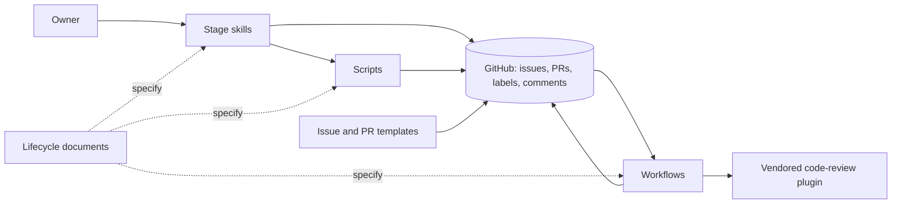

# Architecture

Part of the [Gimli documentation](../../README.md#documentation), in the
architecture layer of the [documentation model](../documentation-model.md).

How Gimli is built today: its parts, how they work together, and the
principles changes are reviewed against. What Gimli does is in the
[specs](../specs/README.md); why it is built this way is in the
[ADRs](../adr/README.md).

## Parts

| Part | Where | What it does |
|---|---|---|
| Lifecycle documents | `docs/` | The specification every other part implements. |
| Stage skills | `.claude/skills/` | Run a lifecycle stage in Claude Code, invoked as `/<stage> <issue>`; each starts with the shared preamble. |
| Scripts | `scripts/` | Deterministic helpers for stage and risk labels, the duplicate guard, and the ruleset. |
| Templates | `.github/ISSUE_TEMPLATE/`, `.github/PULL_REQUEST_TEMPLATE.md` | Shape the work item that starts the cycle and the pull request that carries the evidence. |
| Workflows | `.github/workflows/` | Run the AI review when a pull request is marked ready, and answer `@claude` mentions. |
| Vendored plugin | `vendor/claude-plugins/`, `.claude-plugin/` | The `code-review` plugin the AI review runs, copied verbatim from upstream. |
| GitHub | the repository | The system of record: issues, pull requests, labels, comments, and the `protect-main` ruleset. |

## Principles

Changes are reviewed against these. Each links to where it is defined.

- **GitHub is the system of record.** Anything that matters is written to an
  issue or pull request, not only to a conversation
  ([`lifecycle.md`](../lifecycle.md#principles)).
- **Documentation is the specification.** A change updates the documents
  that describe what it changes, in the same pull request
  ([documentation rule](../lifecycle.md#documentation-rule)).
- **Progressive disclosure.** Short layers that link down to detail
  ([ADR 0001](../adr/0001-progressive-disclosure.md)).
- **Scripts are small, deterministic, and use only `gh` and POSIX shell,** so
  they run on Windows, macOS and Linux ([`scripts/README.md`](../../scripts/README.md)).
- **Record before acting.** The scripts that change issue or pull request
  labels or state, `stage.sh` and `risk.sh`, post their comment first, so a
  failure part way leaves the change documented
  ([STAGE-4](../specs/stage-transitions/spec.md#requirement-stage-4-comment-before-label)).
- **Pinned and vendored dependencies.** Workflow actions are pinned and the
  review plugin is vendored, never edited by hand
  ([`workflow-dependencies.md`](../workflow-dependencies.md)).

## Where the documents in docs/ fit

The documents directly in `docs/`, outside the three layer folders, stay where
they are. This table places each one in a layer; a new one is added here.

| Document | Layer | Notes |
|---|---|---|
| [`documentation-model.md`](../documentation-model.md) | None: it describes the layers | The top of the documentation below `README.md`, and the rule for where a new document goes. |
| [`lifecycle.md`](../lifecycle.md) | Specs | The functional specification of the lifecycle, not yet in capability format. A candidate for conversion. |
| [`risk-assessment.md`](../risk-assessment.md) | Specs | The functional specification of risk tiers, not yet in capability format. A candidate for conversion. |
| [`ai-review.md`](../ai-review.md) | Architecture | How the AI review workflow and its fallback behave. |
| [`workflow-dependencies.md`](../workflow-dependencies.md) | Architecture | What the workflows pin and load, and how to update them. |
| [`repository-settings.md`](../repository-settings.md) | Architecture | The `protect-main` ruleset and merge settings. |
