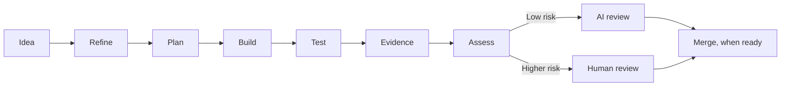

# Development lifecycle

This document defines the Gimli development lifecycle. It is the specification
that Gimli's skills, agents, and GitHub automation implement. When tooling and
this document disagree, one of them is wrong and must be fixed.

## Principles

- **GitHub is the system of record.** Issues are work items, pull requests are
  the unit of delivery, and comments and labels form the audit trail. Anything
  that matters is written there, not only in an agent conversation.
- **Human involvement follows risk, not ceremony.** Every change is assessed
  using `risk-assessment.md`. Low-risk changes may proceed autonomously;
  higher-risk changes are presented to a human with everything needed for an
  effective review.
- **Each stage has explicit exit criteria.** A stage is complete only when its
  exit criteria are met and its artifact exists. Stages are not skipped.
- **Evidence over assertion.** A claim that something works is backed by test
  output, screenshots, or logs attached to the pull request.

## Stage status

Stage progress is recorded on the issue with labels of the form
`stage:<name>`, for example `stage:refine` or `stage:build`. Exactly one stage
label is present at any time. The risk tier is recorded with `risk:<tier>`.

Change the stage with `scripts/stage.sh <issue> <stage> [note]`. It swaps the
label and posts a `Stage: <old> → <new>` comment so the transition is in the
audit trail. Do not edit stage labels by hand.

## Stages

### 1. Idea

A need, bug, or improvement is captured as a GitHub issue using the work item
template.

| | |
|---|---|
| Entry | Someone has something they want changed. |
| Artifact | A GitHub issue created from the work item template. |
| Exit | The issue exists with at least a title and a goal statement. Fields may be incomplete. |
| Label | `stage:refine` is applied on creation. |

### 2. Refine

The issue is clarified interactively until it is sufficiently defined to plan.
Gimli asks questions, proposes wording, and updates the issue body.

| | |
|---|---|
| Entry | Issue exists with `stage:refine`. |
| Activity | Clarify goal, scope (in and out), requirements, acceptance criteria, technical considerations, and expected test evidence. Split the issue if it is too large. |
| Artifact | Updated issue body with all template sections filled. |
| Exit | Acceptance criteria are specific and testable. Expected test evidence is named. Scope boundaries are stated. A preliminary risk tier is proposed. |
| Label | `stage:plan` |

### 3. Plan

An implementation plan is produced and recorded on the issue.

| | |
|---|---|
| Entry | Issue has `stage:plan`. |
| Activity | Inspect the codebase, identify affected files and components, decide on approach, list steps, identify tests to add or change, confirm or revise the risk tier. |
| Artifact | A plan posted as an issue comment, headed `## Plan`. |
| Exit | The plan lists concrete steps, files or areas affected, the tests that will prove each acceptance criterion, and the assessed risk tier with reasoning. For `risk:high` and above, a human has acknowledged the plan with a comment or reaction before Build starts. |
| Label | `stage:build`; `risk:<tier>` applied. |

### 4. Build

The change is implemented on a branch.

| | |
|---|---|
| Entry | Issue has `stage:build`. |
| Activity | Create a branch named per `CLAUDE.md` conventions. Implement following the plan. Add or update tests. Commit in logical steps. Deviations from the plan are noted as issue comments. |
| Artifact | A branch with commits, and a draft pull request referencing the issue. |
| Exit | All planned steps are implemented or explicitly deferred with a reason recorded on the issue. The draft pull request exists. |
| Label | `stage:test` |

### 5. Test

Automated tests are run against the change.

| | |
|---|---|
| Entry | Draft pull request exists with `stage:test`. |
| Activity | Run the full automated test suite locally and in CI. Run any manual or exploratory checks the plan called for. Fix failures and return to Build if the fix is non-trivial. |
| Artifact | Green CI on the pull request. Test output captured. |
| Exit | CI is green. Every acceptance criterion has at least one test or check that exercises it. |
| Label | `stage:evidence` |

### 6. Evidence

The pull request is completed with everything a reviewer needs.

| | |
|---|---|
| Entry | `stage:evidence`. |
| Activity | Fill the pull request template: summary, linked issue, acceptance criteria and evidence (one row per criterion, keyed by the criterion's `AC<n>` identifier), test output or screenshots, known limitations, deviations from plan (summarising the deviation comments on the issue). Leave the Risk assessment section for the Assess stage. |
| Artifact | A complete pull request body following `.github/PULL_REQUEST_TEMPLATE.md`. |
| Exit | Each acceptance criterion has a stated evidence item. The pull request is marked ready for review. |
| Label | `stage:assess` |

### 7. Assess

The final risk tier is determined and the review path is chosen.

| | |
|---|---|
| Entry | Pull request is ready for review with `stage:assess`. |
| Activity | Re-evaluate risk against `risk-assessment.md` using the actual diff, not the plan. Compare with the tier set at Plan. Fill the Risk assessment section of the pull request body with the tier and justification; if the tier changed, explain what changed. |
| Artifact | `risk:<tier>` label on the pull request and a completed Risk assessment section in the pull request body. |
| Exit | Risk tier is final and the review path is selected. |
| Label | `stage:review` |

### 8. Review

The change is reviewed by the path the risk tier requires.

| Tier | Review path |
|---|---|
| `risk:low` | AI review. A human may review but is not required. |
| `risk:medium` | AI review plus at least one human approval. |
| `risk:high` | AI review plus human approval from a code owner. The reviewer confirms evidence against acceptance criteria. |
| `risk:critical` | As high, plus a second human approval. |

| | |
|---|---|
| Entry | `stage:review`. |
| Activity | AI review runs on every pull request. Findings are addressed or explicitly dismissed with a reason. Human review as required by tier. |
| Artifact | Approvals and resolved review threads on the pull request. |
| Exit | All required approvals are present. All review threads are resolved. CI is green. |
| Label | `stage:merge` |

### 9. Merge

The change is merged and the issue is closed.

| | |
|---|---|
| Entry | `stage:merge`. |
| Activity | Squash or merge per repository settings. `risk:low` pull requests may auto-merge. Then run `scripts/stage.sh <issue> close "Merged in #<pr>"`: it removes the stage label and records the transition whether or not GitHub already closed the issue through a closing keyword. The branch is deleted. |
| Artifact | Merge commit on `main`; closed issue. |
| Exit | Change is on `main`. Issue is closed. |
| Label | None; the issue is closed. |

## Returning to an earlier stage

Any stage may send work back to an earlier one. When that happens:

1. Run `scripts/stage.sh <issue> <stage> "<reason>"`. It posts the comment and
   moves the label, and reopens the issue if it was closed.
2. Continue from that stage's entry criteria.

Common returns: Plan reveals the issue is underspecified (back to Refine);
Test reveals a design problem (back to Plan); Review requests changes
(back to Build).

## What is not yet automated

This document describes the target process. Stages without a skill below are
executed by a person working with Claude Code interactively, using
`scripts/stage.sh` for transitions.

| Stage | Implementation |
|---|---|
| Idea | Issue template `.github/ISSUE_TEMPLATE/work-item.yml` |
| Refine | `/refine <issue>` skill in `.claude/skills/refine/` |
| Plan | `/plan <issue>` skill in `.claude/skills/plan/` |
| Build | Manual |
| Test | Manual |
| Evidence | Pull request template `.github/PULL_REQUEST_TEMPLATE.md`, filled manually |
| Assess | Manual |
| Review | AI review via the `code-review` skill, run manually |
| Merge | Manual, with `scripts/stage.sh <issue> close` |
